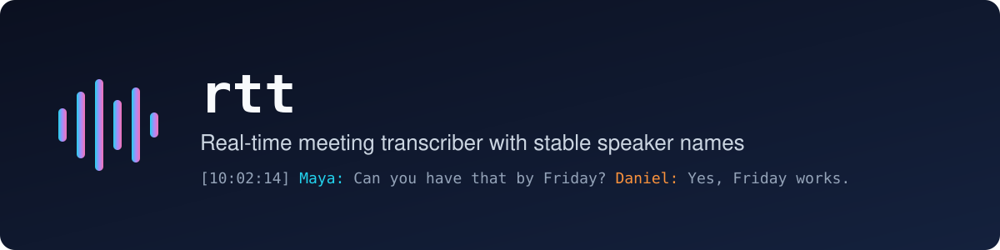
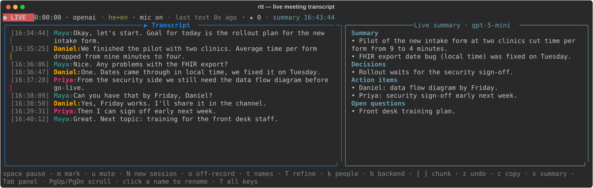

<div align="center">



[](https://github.com/idanshimon/rtt/actions/workflows/tests.yml)


**Live transcript of any meeting (Teams, Zoom, Meet, a podcast) with speaker names that stay the same all meeting.**
<br/>Works with any app: it listens to your computer's audio and your mic. No bot joins the call.

</div>

---

## 🖥️ What it looks like

<div align="center">

<br/><sub>Rendered from the real UI code with an invented meeting (<code>scripts/render_readme_screenshot.py</code>).</sub>
</div>

Transcript on the left, live summary on the right, single-key controls along the bottom.
Click a speaker's name to rename them everywhere, including the summary.

---

## 🧰 Features

| | Feature | What it does |
|---|---|---|
| 🎧 | **Any meeting app** | Captures system audio (BlackHole on macOS, WASAPI loopback on Windows, PulseAudio/PipeWire on Linux) plus your mic |
| 🗣️ | **Stable speakers** | Voice embeddings keep "Speaker 1" the same person across chunks; click to rename |
| 🔀 | **Six backends** | Local Whisper, Azure OpenAI diarize, Azure LLM Speech, MAI-Transcribe, classic Azure Speech, local VibeVoice. Switch live with `b` |
| 🇮🇱 | **Mixed languages** | Hebrew/English code-switching on the LLM Speech and VibeVoice backends |
| 📝 | **Live summary** | Summary, decisions, action items and open questions, updated as the meeting runs (optional) |
| ⏸️ | **Session controls** | Pause, mute your mic, bookmark, off the record, undo, new session, resume after a crash |
| 🏷️ | **Real names from Teams/Zoom** | Copy the app's own transcript, press `t`, and RTT puts the real names on its lines |
| 🔤 | **Domain vocabulary** | Your list of terms (FHIR, DevOps, product names) is spelled right on every backend |
| 🤖 | **Agent control** | `rtt-ctl` from any terminal, plus an MCP server so a coding agent can drive a session |
| 🎙️ | **Recording** | `--record` saves meeting and mic tracks as FLAC; `rtt-post` re-transcribes them later |
| 🔒 | **Private by default** | Transcripts and audio stay in local, git-ignored folders. The `local` backend sends nothing anywhere |

---

## ⚡ Quick start

**macOS / Linux**
```bash
git clone https://github.com/idanshimon/rtt.git
cd rtt
./install.sh
```

**Windows (PowerShell, beta)**
```powershell
git clone https://github.com/idanshimon/rtt.git
cd rtt
.\install\windows.ps1
```

The installer sets up a virtualenv, configures audio capture for your OS (on macOS it installs
BlackHole and creates an `RTT Multi-Output` device) and runs a short audio smoke test.

Then pick a backend:

```bash
./run.sh --backend local --model-size base   # fully local, no account needed
./run-openai.sh                              # Azure OpenAI gpt-4o-transcribe-diarize
./run-llmspeech.sh                           # Azure LLM Speech, Hebrew + English
```

Cloud backends need an Azure resource in your own subscription; copy `.env.example` to `.env`
and fill in the endpoint. Sign-in uses `az login` (no keys needed). Check what RTT will use,
without recording anything:

```bash
./run-openai.sh --show-config
```

---

## 🔀 Backends

| Backend | Script | Runs on | Speakers | Best for |
|---|---|---|---|---|
| `local` | `run.sh` | Your machine (faster-whisper) | — | Offline, nothing leaves the machine |
| `openai` | `run-openai.sh` | Azure OpenAI `gpt-4o-transcribe-diarize` | ✅ | English meetings, best accuracy per cost |
| `llmspeech` | `run-llmspeech.sh` | Azure Speech LLM Speech | ✅ | Hebrew/English mixed meetings |
| `mai` | `run-mai.sh` | Azure Speech MAI-Transcribe-2 | ✅ | Evaluation |
| `azure` | `run-azure.sh` | Azure Speech SDK Conversation Transcriber | ✅ | True streaming, lowest lag |
| `vibe` | `run-vibe.sh` | Local VibeVoice-ASR 7B server you run | ✅ | Local multilingual (~22 GB memory) |

The REST backends work in chunks of about 10 seconds, so text lands a few seconds after it is said.
Details, auth and tuning: [docs/USAGE.md](docs/USAGE.md).

---

## ⌨️ Keys

`space` pause · `m` mark · `u` mute mic · `o` off the record · `N` new session · `b` switch backend ·
`t` names from Teams/Zoom · `z` undo · `c` copy transcript · `s` copy summary · `q q` stop · `?` all keys

From another terminal: `rtt-ctl status | pause | resume | mark "note" | mute | stop`.
Full list: [openspec/README.md](openspec/README.md#quick-reference).

---

## 🗺️ Repository map

| Path | What it is |
|---|---|
| `transcribe.py` | CLI entry point, capture, local and Azure SDK backends |
| `chunked_backends.py` | REST backends (OpenAI, LLM Speech, MAI, VibeVoice) |
| `session.py`, `tui.py` | Session controls and the split-view terminal UI |
| `speakers.py` | Voice tracking that keeps speaker labels stable |
| `summarizer.py` | Optional live summary |
| `meetalign/` | Standalone library: align a transcript with one copied from Teams/Zoom |
| `rtt_cli.py`, `config_schema.py` | `rtt-cli` menu, wizard and chat over every option |
| `rtt_ctl.py`, `rtt_mcp.py` | Control from another terminal or from an agent (MCP) |
| `install/`, `install.sh` | OS installers and audio setup |
| `infra/` | Bicep for an Azure Speech resource |
| `openspec/` | One spec per feature, plus the quick reference |
| `docs/` | [Usage guide](docs/USAGE.md), [architecture](docs/ARCHITECTURE.md) |
| `tests/` | 200+ tests, no network or audio device needed |

---

## 🔒 Privacy and consent

Recording a conversation may require everyone's consent where you live. Tell people, and get
consent. What leaves your machine for each backend is listed in [SECURITY.md](SECURITY.md).

## 🤝 Contributing

See [CONTRIBUTING.md](CONTRIBUTING.md). Run the tests with `python -m pytest tests -q`.

## 📄 License

MIT, see [LICENSE](LICENSE). Third-party packages and models keep their own licenses:
[NOTICE.md](NOTICE.md).
