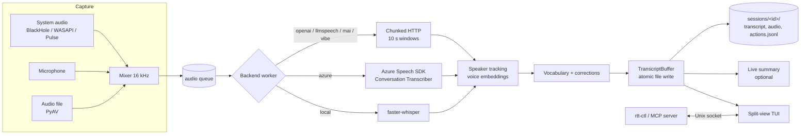

# Architecture

## Backend layers

Every backend has the same three layers, so `main()` can treat them alike:

1. **Backend class** owns the model or connection: `LocalWhisperBackend`, `AzureSpeechBackend`
   (in `transcribe.py`), and the chunked HTTP backends in `chunked_backends.py`
   (`OpenAITranscribeBackend`, `LLMSpeechBackend`, MAI and VibeVoice).
2. **Worker** `process_<x>_backend(backend, audio_queue, stop_event, paused_event, emit)` drains
   the audio queue, feeds the backend and emits lines.
3. **Dispatch** in `main()` picks the worker from `--backend`.

To add a backend: add a `BACKEND_*` constant, a CLI option block, the dispatch branch, and a
`Field(...)` in `config_schema.py` for each new option.

## Chunked backends

The REST backends buffer `--chunk-seconds` of audio (default 10 s), send it as one WAV, and emit
the returned lines with the time each was spoken. Built-in resilience:

- **Silence gate**: near-silent chunks are skipped.
- **Auth refresh in place**: a 401/403 mints a fresh token and retries once. The transcriber is
  never restarted, so speaker labels stay stable through a token expiry.
- **Retry with backoff** for 5xx, 429 and network errors; after 3 failures in a row a single
  `⚠️ RTT BACKEND DOWN` line goes into the transcript, and `⚠️ RTT RECOVERED` when it is back.

Speaker labels from these models are only valid inside one chunk. `speakers.py` matches voices
across chunks (sherpa-onnx embeddings) so "Speaker 1" means the same person all meeting.

## Session layer

`session.py` owns pause, mute, bookmarks, off-the-record, backend switch and new-session
rollover. Every user action is appended to `sessions/<id>/actions.jsonl`, which also powers undo.
`tui.py` draws the split view; `rtt_ctl.py` and `rtt_mcp.py` send the same actions through the
control socket. `meetalign/` is a standalone library (no RTT imports) that aligns RTT lines with
a transcript copied from Teams or Zoom to fix names and wording.

Feature-level detail: [openspec/README.md](../openspec/README.md).
